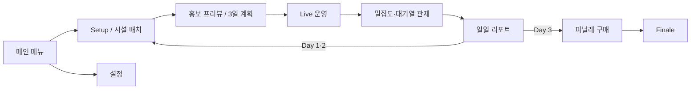

# FESTA FIESTA UX/UI Concept Set

프로젝트의 실제 Unreal Engine 코드, UI 계약, 입력 설정, 데이터 테이블, 시설 아트를 바탕으로 만든 협업용 목표 디자인입니다. 일반적인 축제 앱이 아니라 **부산 다대포 해변 디지털 트윈 축제 운영·건설 시뮬레이션**의 PC 16:9 화면을 기준으로 합니다.

> 이 폴더의 PNG는 구현 완료 화면 캡처가 아니라 제품 방향을 맞추기 위한 target-design mockup입니다. 현재 코드에서 스텁인 밀집도 원본 데이터, 일부 KPI 소유 API, 원인 드릴다운 등은 목표 UX로 시각화했습니다.

## 화면 세트

| 파일 | 화면 | 핵심 협업 판단 |
| --- | --- | --- |
| `00-main-menu.png` | 메인 메뉴 | GlassOrbit 해양 브랜드, 플레이 포커스, 다대포 노을 |
| `01-live-operations.png` | 라이브 운영 | 월드 중심 HUD, 운영 KPI, 시설 상세, 9탭·시간 제어 |
| `02-build-mode.png` | 건축 — 배치 가능 | 카탈로그와 월드 동시 노출, footprint/clearance/queue, 회전·배치 |
| `02b-build-invalid-placement.png` | 건축 — 배치 불가 | 보호 동선 충돌, 색+해칭+X+문구, 해결 행동 피드백 |
| `03-density-queues.png` | 밀집도·대기열 | Crowd 셀 `DensityPerSqm`, Fruin A–F, 시설별 대기·처리량 |
| `04-promotion-planning.png` | 3일 운영·홍보 계획 | 전일정 조망, 방문객 배수, 예산·스태프 trade-off |
| `05-end-of-day-report.png` | 일일 리포트 | 관측 사실 → 지표 영향 → 내일 바꿀 행동 |
| `06-settings.png` | 설정 | 화면/오디오/게임플레이/조작/접근성, 카메라·밀집 표시 옵션 |
| `07-finale-purchase.png` | 피날레 구매 | C/B/A/S 비용·보너스·예상 평가 점수 비교 |
| `FestaFiesta-UXUI-contact-sheet.png` | 콘택트시트 | 9개 화면을 한 장에서 비교하는 리뷰용 보드 |

모든 개별 화면은 `1672 × 941` PNG이며 16:9 비율입니다.

## 사용자 흐름

실제 Stage enum에는 `Setup`, `PromotionPreview`, `SunsetTransition`, `MorningCheck`, `Live`, `Closing`, `Report`, `Finale`가 있습니다. Report의 `다음 날`은 Day 1·2 진행 게이트이며 Day 3은 Finale로 연결됩니다.

## 디자인 시스템

### 브랜드와 월드

- 키워드: **다대포 해변, 디지털 트윈, 해양 궤도, 한국형 야시장, 따뜻한 운영 감성**
- 시설: 청록 지붕/천막, 어두운 목재, 주황 랜턴, 곡선 처마, 파도·노을 문양
- 카메라: 높은 3/4 탑다운 전략 시점. 위성 GIS나 1인칭 화면으로 표현하지 않음
- 캐릭터: 주인공 중심 구도 대신 작은 저폴리 방문객 그룹과 물리 대기열

### UI 토큰

| 역할 | 값 |
| --- | --- |
| LightTeal White | `#FFFFFF` |
| Teal | `#527C6B` |
| Deep Teal | `#315747` |
| Soft Teal | `#B4C8BB` |
| Beige | `#E7E3E3` |
| Ink | `#24332E` |
| Amber / Caution | `#E39A22` |
| Danger | `#D74E43` |
| Info | `#3D86B4` |
| Build Accent | `#14F2E0` 근사 |
| Report Backdrop | `#05090A` |
| Report Raised | `#161F21` |
| Report Mint | `#6DD2BA` |

- 한글/본문: Pretendard Medium·SemiBold 계열
- 영문 타이틀: Michroma/확장형 기하 산세리프 계열
- 상태는 색만으로 알리지 않고 아이콘, 라벨, 패턴, 테두리를 함께 사용
- 전체 화면 기준 8px spacing grid, 8–18px corner, 얇은 경계선과 절제된 그림자
- Live HUD 하단은 프로젝트 규격대로 메뉴 29px + 상태 29px의 2단 구조를 목표로 함

## 화면별 구현 메모

### Live 운영

- 월드 가시성을 위해 중앙 65–70%를 비워 둡니다.
- 하단 탭 순서는 `운영 / 시설 / 관객 / 대기열 / 밀집도 / 사건 / SNS / 리포트 / 스태프`입니다.
- Live에서는 `SimSatisfaction` 하나만 보여 주고, `ScoreSatisfaction`은 Report/Finale에서 사용합니다.
- `Gold`는 잔액, 매출은 성과값이므로 같은 값처럼 묶지 않습니다.

### 건축

- 카테고리: Booth, Performance, Toilet, Info, Safety, Rest, PhotoSpot.
- 범위 색 의미: footprint=초록(유효)/빨강+해칭(무효), clearance=청록, queue reservation=노랑.
- 배치 거절은 보호 동선·구역 경계·충돌·지면·경사·내비·예산 등의 실제 검증 사유를 사용합니다.
- 기본 조작: `B`, `Q/E`, 좌클릭, 우클릭, `Esc`; 이동은 `M`, 확정/철거는 `Enter` 흐름을 유지합니다.

### 밀집도·대기열

- Heat map은 Zone `ReportedPopulation / SoftCapacity`가 아니라 Crowd cell의 `DensityPerSqm`를 사용합니다.
- Fruin 경계: A `0.00–0.30`, B `0.31–0.42`, C `0.43–0.71`, D `0.72–1.07`, E `1.08–2.16`, F `2.17+` 명/㎡.
- 대기열은 별도 카드에서 대기 인원, 예상 시간, 처리량(명/시간)을 표시합니다.

### 홍보·경제·피날레

- 홍보: 안 함 `0 ×1.00`, 기본 `500 ×1.08`, 집중 `1,200 ×1.18`.
- 초기 자원: Gold `10,000`, Staff `6`, 일일 방문객 목표 `500`.
- 피날레: C `2,000/+5`, B `4,000/+12`, A `6,000/+20`, S `8,000/+30`.
- 구매 전 `SimSatisfaction + FinaleBonus = 예상 ScoreSatisfaction`을 직접 보여 줍니다.

### Report

- 3열 정보 흐름은 점수 나열이 아니라 `관측 사실 → 지표 영향 → 내일 바꿀 행동`입니다.
- `관객 만족도 62 + 피날레 20 = 평가 점수 82`처럼 두 만족도 지표의 관계를 화면 자체에서 설명합니다.
- Day 1·2의 `다음 날` 버튼은 게임 진행을 여는 필수 CTA입니다.

### 설정

- PC 키보드·마우스·게임패드 기준입니다. 모바일/touch 설정을 넣지 않습니다.
- 카메라 팬/회전/45° 스냅/커서 줌/가장자리 스크롤과 UI 배율을 노출합니다.
- 밀집도 표시는 `색상 + 패턴`을 제공해 색각 의존을 줄입니다.

## 프로젝트 근거

- `Source/FestaFiesta/Public/UI/FF_LiveHudMenuBar.h`（10/14 기준 위치: `Public/UI/LiveHUD/FF_LiveHudMenuBar.h`）
- `Source/FestaFiesta/Public/UI/FF_LiveHudStatusBar.h`（10/14 기준 위치: `Public/UI/LiveHUD/FF_LiveHudStatusBar.h`）
- `Source/FestaFiesta/Public/UI/FF_ReportScreen.h`（10/14 기준 위치: `Public/UI/Report/FF_ReportScreen.h`）
- `Source/FestaFiesta/Private/UI/FF_ReportScreenWbpBuilder.cpp`（10/14 기준 위치: `Source/FestaFiestaEditor/Private/UI/Report/FF_ReportScreenWbpBuilder.cpp`）
- `Source/FestaFiesta/Private/Building/UI/FF_BuildCatalogWbpBuilder.cpp`（10/14 기준 위치: `Source/FestaFiestaEditor/Private/Building/UI/FF_BuildCatalogWbpBuilder.cpp`）
- `Source/FestaFiesta/Public/Building/FF_BuildModeSubsystem.h`
- `Source/FestaFiesta/Public/Time/FF_FestivalStage.h`
- `Source/FestaFiesta/Public/Festival/FF_FestivalDefinition.h`
- `Source/FestaFiesta/Public/Economy/FF_FestivalEconomyTypes.h`
- `Source/FestaFiesta/Public/CrowdSystem/Systems/FF_CrowdDensityGrid.h`
- `Source/FestaFiesta/Public/Queue/FF_QueueSubsystem.h`
- `Config/DefaultGame.ini`, `Config/DefaultInput.ini`, `Config/DefaultEngine.ini`
- `UI_API.md`

## 범위에서 제외한 것

- 멀티플레이 로비, 친구 초대, 채팅, 보이스
- 플레이어 파티 UI (`Party`는 NPC 방문객 그룹임)
- RPG 퀘스트·인벤토리·업적 화면
- 실시간 위성/GIS 화면(Cesium은 현재 비활성)
- 구현 근거가 없는 저장 슬롯/클라우드 화면

## 생성·검수

이미지는 Codex 내장 ImageGen으로 생성·편집했습니다. 프로젝트의 시설 썸네일/지도 배경과 먼저 생성한 승인 화면을 reference image로 사용했습니다. 원본 생성물은 보존하고 이 폴더에 비파괴 복사했습니다. 모든 개별 PNG는 원본 크기에서 텍스트, 수치, 선택 상태, 위험 상태, 잘림 여부를 시각 검수했습니다.
