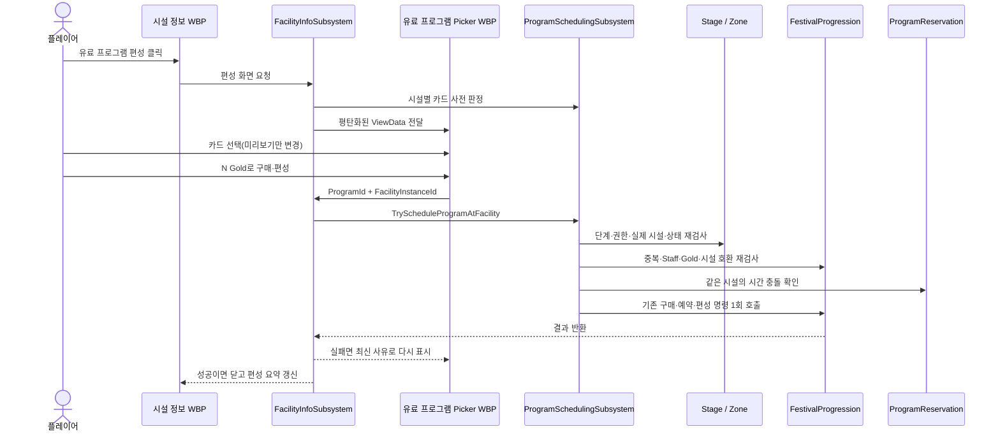

# 시설 기반 유료 프로그램 구현·운영 가이드

> 기준일: 2026-08-28  
> 대상: 기획자, UI 디자이너, 클라이언트 프로그래머, QA  
> 핵심 결정: 프로그램을 먼저 사서 보관하는 방식이 아니라, **시설을 고른 상태에서 구매와 편성을 한 번에 확정**한다.

## 1. 결론부터 보기

시설 클릭 흐름에 유료 프로그램 기능을 독립적으로 연결했다.

1. 준비 단계에서 설치된 시설을 클릭한다.
2. 시설 정보 패널에서 당일 편성 상태를 확인한다.
3. **유료 프로그램 편성**을 눌러 그 시설에서 운영할 수 있는 프로그램을 본다.
4. 카드를 한 번 눌러 시간·비용·필요 인원·정원·참가비를 미리 본다.
5. 별도의 **N Gold로 구매·편성** 버튼을 눌러 최종 확정한다.
6. 서버 권한 경계가 최신 상태를 다시 검사하고, 성공했을 때만 기존 경제·예약 시스템에 명령을 전달한다.
7. 성공하면 피커가 닫히고 시설 패널에 편성 결과가 즉시 표시된다.

이 방식은 “돈은 냈지만 어느 시설에도 배치되지 않은 프로그램”을 만들지 않는다. 프로그램 카드 선택과 실제 결제 버튼도 분리해 오클릭 결제를 막았다. 구매·편성 뒤 당일 취소와 환불은 지원하지 않으며, 피커에 이를 명시한다.

## 2. 이번 작업에서 직접 완성한 범위

- 시설 정보 패널의 편성 상태, 요약, 제한 사유, 편성 버튼
- 시설 전용 프로그램 피커와 프로그램 카드 WBP
- 카드 선택은 미리보기만 하고, 별도 버튼에서 구매·편성하는 2단계 UX
- 현재 시설과 호환되는 프로그램만 목록에 표시
- Gold·Staff 부족, 당일 중복, 시설 시간 충돌 등 카드별 현재 상태 표시
- 결제 직전 단계·권한·시설 실재 여부·시설 상태·경제·예약을 다시 확인하는 단일 명령 창구
- 편성된 시설의 이동과 철거를 BuildMode와 Zone 최종 정책 양쪽에서 차단
- 기획 데이터의 독립 검증 함수와 관련 자동화 테스트 코드
- 기존 시설 WBP를 보존하는 비파괴 마이그레이션 명령

다음 항목은 담당 팀원의 기존 시스템에 연결해야 하므로 이번 작업에서 수정하지 않았다.

- 예약 손님을 실제 Crowd 생성·이동·도착·정산 흐름에 연결
- 기존 PrepHUD Program 탭도 같은 최종 명령 창구를 사용하도록 통일
- 기존 경제 저장소의 알림 순서를 완전한 트랜잭션으로 보강
- 기획 검증 함수를 Festival DataAsset의 **Validate Assets** 메뉴에 자동 연결

자세한 전달 문구는 `Design/Collaboration/FestaFiesta_PaidProgram_Team_Handoff.md`에 있다（10/14 기준 위치: 저장소 루트 `Collaboration/FestaFiesta_PaidProgram_Team_Handoff.md`）.

## 3. 플레이어 화면에서 실행되는 순서

### 3.1 열기

- 가능한 시점: `Setup` 또는 `MorningCheck`
- 대상: 현재 월드에 실제로 설치되어 있고, 배치가 확정된 시설
- 진입: 시설 클릭 → 시설 정보 → **유료 프로그램 편성**

시설이 재배치가 필요하거나 운영 중인 상태라면 버튼이 비활성화되고 이유가 표시된다. 이미 프로그램이 편성된 시설은 해당 프로그램의 이름과 시간을 요약해서 보여 준다.

### 3.2 고르기

- 선택 시설과 맞지 않거나 데이터 자체가 잘못된 카드는 목록에서 제외된다.
- 시설에는 맞지만 Gold·Staff 부족, 중복, 시간 충돌 등으로 지금 구매할 수 없는 카드는 목록에 남고 사유를 보여 준다.
- 카드를 눌러도 결제되지 않는다. 미리보기 내용만 바뀐다.
- 미리보기에는 시간, 필요 인원, 정원, 1인 참가비, 구매 비용, 최대 매출을 표시한다.

### 3.3 확정

- 가능한 카드만 **N Gold로 구매·편성** 버튼이 활성화된다.
- 버튼을 누르는 순간 최초 클릭 때의 정보가 아니라 현재 월드 상태로 모든 조건을 다시 검사한다.
- 성공하면 피커가 닫히고 시설 정보가 다시 그려진다.
- 실패하면 피커를 유지한 채 최신 실패 이유를 표시한다.

## 4. 실제 코드 처리 흐름



화면은 게임 시스템을 직접 찾지 않는다. C++가 한 번 계산한 ViewData만 WBP에 전달한다. 따라서 Blueprint의 매 프레임 바인딩, UI별 규칙 중복, 화면과 실제 명령의 판정 차이를 줄였다.

## 5. 최종 확정 전에 검사하는 것

다음 순서 중 하나라도 실패하면 구매·편성을 시작하지 않는다.

1. 축제가 시작되었는가
2. 서버 권한이 있는가
3. 현재가 `Setup` 또는 `MorningCheck`인가
4. 시설 고유 번호가 유효하고 현재 Zone에 실제 시설로 등록되어 있는가
5. 시설이 재배치 대기 상태가 아닌가
6. 시설 상태가 `Validated` 또는 `Closed`인가
7. 프로그램 ID와 카드 값이 유효한가
8. 카드와 시설의 `대분류_소분류`가 호환되는가
9. 오늘 같은 프로그램을 이미 편성하지 않았는가
10. 남은 Staff가 충분한가
11. Gold가 충분한가
12. 예약 시스템이 존재하는가
13. 같은 시설에 시간이 겹치는 다른 예약이 없는가

시간 충돌은 “10~11시 다음에 11~12시는 가능하지만, 10~12시와 11~13시는 불가”한 방식이다.

편성 뒤에는 `UFF_ProgramFacilityProtectionSubsystem`이 Zone의 이동·철거 명령 최종 경계에서도 시설을 보호한다. BuildMode 버튼에서만 막는 방식이 아니므로 다른 명령 발행 경로도 같은 규칙을 따른다.

## 6. 역할별 유지보수 경계

| 영역 | 책임 | 변경하는 사람 |
|---|---|---|
| Festival DataAsset | 프로그램 이름, 가격, 인원, 시간, 허용 시설 | 기획자 |
| Facility/Picker/Card WBP | 위치, 크기, 폰트, 색, 패딩, 애니메이션 | UI 디자이너 |
| FacilityInfoSubsystem | 시설 상태를 화면용 ViewData로 변환 | 시설 UI 담당 |
| ProgramSchedulingSubsystem | 최종 권한 검사와 명령 진입점 | 기능 담당 |
| FestivalProgression / Reservation | Gold·Staff·원장·당일 편성·예약 저장 | Economy/NPC 담당 |
| Crowd | 예약 참가자의 실제 생성·이동·도착 | Crowd 담당 |

UI 변경 때문에 경제 코드를 고치거나, 프로그램 가격 변경 때문에 C++를 다시 컴파일하지 않는 구조가 목표다.

## 7. 기획자가 프로그램을 바꾸는 방법

### 7.1 편집 위치

Content Browser에서 다음 DataAsset을 연다.

`/Game/FestaFiesta/Data/Festivals/DA_Festival_Busan`

`ProgramCatalog` 배열에서 항목을 추가·삭제·수정하고 저장한다. 런타임 UI와 판정은 이 카탈로그를 읽으므로 숫자나 허용 시설을 바꾸는 데 C++ 재컴파일은 필요 없다.

### 7.2 필드 설명

| 필드 | 쉬운 뜻 | 작성 규칙 |
|---|---|---|
| `ProgramId` | 저장 데이터가 프로그램을 구별하는 내부 이름 | 비우거나 중복하지 않기, 출시 뒤 변경하지 않기 권장 |
| `DisplayName` | 플레이어가 보는 이름 | 빈 값 금지 |
| `CostGold` | 구매할 때 한 번 내는 금액 | 1 이상 |
| `RequiredStaff` | 당일 이 프로그램에 묶이는 인원 | 1 이상 |
| `Capacity` | 받을 수 있는 최대 참가자 수 | 1 이상 |
| `FeePerPerson` | 실제 참가자 1명에게 받는 금액 | 1 이상 |
| `StartMinutes` | Live 시작 뒤 몇 분에 시작하는지 | 0 이상 |
| `EndMinutes` | Live 시작 뒤 몇 분에 끝나는지 | 시작보다 큰 유한한 값 |
| `PreferredArchetypeId` | 이 프로그램이 부를 손님 유형 | 비워도 됨. 입력하면 `DT_Archetype` ID 사용 |
| `AllowedFacilityTypes` | 프로그램을 열 수 있는 시설 종류 | `대분류_소분류`, 예: `Booth_CraftExperience` |

`AllowedFacilityTypes`가 비어 있으면 모든 시설 종류를 허용한다. 실수로 전체 허용이 되지 않도록 가능한 한 명시하는 것을 권장한다.

### 7.3 데이터 검증 상태

`UFF_ProgramAuthoringValidationLibrary::ValidateProgramCatalog`는 아래 항목을 한 번에 검사한다.

- 비어 있거나 중복된 ID
- 빈 표시 이름
- 0 이하 비용·인원·정원·참가비
- NaN/무한대/음수/역전된 시간
- 중복된 허용 시설
- `대분류_소분류` 형식이 아닌 시설 토큰

현재 이 검증 함수와 테스트 코드는 준비되어 있지만, 팀원 소유 `FestivalDefinition`을 수정하지 않았기 때문에 Content Browser의 **Validate Assets** 메뉴에 자동으로 연결되지는 않았다. 자동 메뉴 연결은 팀원 전달 요청서의 “기획 데이터 표준 검증 연결” 항목을 반영한 뒤 사용한다. 그 전에는 관련 자동화 테스트 또는 Blueprint/Editor Utility에서 이 함수를 호출해야 한다.

## 8. UI 디자이너가 WBP를 바꾸는 방법

### 8.1 에셋 위치

| 화면 | WBP |
|---|---|
| 시설 정보와 편성 상태/버튼 | `/Game/FestaFiesta/Building/FF_WBP_Building/Facility/WBP_FF_FacilityInfoPanel` |
| 프로그램 목록·미리보기·최종 버튼 | `/Game/FestaFiesta/Building/FF_WBP_Building/Facility/WBP_FF_FacilityPaidProgramPicker` |
| 목록의 프로그램 카드 한 장 | `/Game/FestaFiesta/Building/FF_WBP_Building/Facility/WBP_FF_FacilityPaidProgramCard` |

Designer 탭에서 위치·크기·폰트·브러시·패딩·애니메이션을 수정한다. 성공/오류 색, 카드 선택/비선택 색, 카드 WBP 클래스는 각 WBP의 **Class Defaults**에 노출되어 있다.

위젯의 위치나 스타일은 자유롭게 바꿔도 되지만, 다음 이름과 타입은 C++ 연결 계약이므로 유지해야 한다.

### 8.2 시설 정보 WBP 계약

- `Panel_ProgramSection`
- `Text_ProgramStatus`
- `Text_ScheduledProgramSummary`
- `Text_ProgramScheduleReason`
- `Button_ScheduleProgram`
- `Text_ScheduleProgram`

### 8.3 피커 WBP 계약

- `Border_Picker`, `Button_Close`, `Text_FacilityName`, `Text_Empty`
- `ScrollBox_Programs`
- `Text_PreviewName`, `Text_PreviewDescription`, `Text_PreviewDetails`
- `Text_PreviewAvailability`, `Text_NoRefundNotice`, `Text_Feedback`
- `Button_Confirm`, `Text_Confirm`

### 8.4 카드 WBP 계약

- `Button_Select`
- `Text_ProgramName`
- `Text_ProgramMeta`
- `Text_ProgramAvailability`

### 8.5 생성·마이그레이션

에디터 콘솔 명령은 `FF.BuildFacilityInfoUMG`다.

- 새 피커·카드 WBP가 없으면 기본 레이아웃으로 만든다.
- 기존 시설 정보 WBP가 있으면 삭제하거나 다시 만들지 않는다.
- 유료 프로그램 named widget이 빠진 경우에만 기존 `Panel_Content` 아래에 새 블록을 추가한다.
- 이미 계약을 만족하는 에셋은 그대로 재사용한다.
- 부모 클래스나 named widget 타입이 잘못된 기존 에셋은 덮어쓰지 않고 오류를 남긴다.

## 9. 팀원이 연결해야 할 후속 범위

이번 기능은 시설에서 구매·편성하는 진입점까지 완성됐다. 아래는 다른 시스템 담당자의 검토 없이는 사실처럼 안내하면 안 되는 범위다.

1. **Crowd 실제 참가자 흐름**: 예약 주문서를 읽어 손님을 생성하고 시설로 이동시킨 뒤, 어떤 시점에 참가비를 확정할지 연결해야 한다.
2. **기존 Program 탭**: PrepHUD의 기존 구매 경로도 `UFF_ProgramSchedulingSubsystem`을 사용해야 모든 화면이 같은 검사를 받는다.
3. **경제 알림 원자성**: 기존 Progression/Reservation이 중간 상태를 외부 이벤트에 보여 주지 않도록 담당자가 트랜잭션 순서를 검토해야 한다.
4. **Validate Assets 자동 연결**: 독립 검증 함수를 FestivalDefinition의 표준 검증 경로에 호출해야 한다.

따라서 현재 가이드에서는 “프로그램 정원만큼 실제 손님이 이미 자동 생성된다”거나 “기존 Program 탭도 같은 안전 경계를 쓴다”고 주장하지 않는다.

## 10. 사용자가 진행할 테스트 체크리스트

### 기본 UX

- [ ] `Setup`/`MorningCheck`에서 설치 시설 클릭 시 프로그램 영역이 보인다.
- [ ] 편성 버튼을 누르면 해당 시설 이름이 표시된 피커가 열린다.
- [ ] 시설과 맞지 않는 프로그램은 목록에 나타나지 않는다.
- [ ] 카드 클릭만으로 Gold가 줄지 않는다.
- [ ] 최종 버튼에 정확한 구매 비용이 표시된다.
- [ ] 성공하면 피커가 닫히고 시설 패널에 프로그램 요약이 보인다.
- [ ] 닫기 버튼, 시설 선택 변경, 단계 변경 시 피커가 안전하게 닫힌다.

### 규칙과 실패 처리

- [ ] Gold 부족, Staff 부족, 당일 중복, 시설 시간 충돌 이유가 표시된다.
- [ ] 실패한 최종 요청에서 이중 차감이 발생하지 않는다.
- [ ] `PromotionPreview`/`Live`에서는 구매할 수 없다.
- [ ] 재배치가 필요한 시설에는 편성할 수 없다.
- [ ] 편성된 시설은 이동·철거할 수 없다.
- [ ] 앞 프로그램 종료와 다음 프로그램 시작이 같은 경우는 허용된다.

### WBP

- [ ] 세 WBP를 열어 Compile 오류가 없다.
- [ ] 16:9 화면에서 피커와 시설 패널이 잘리지 않는다.
- [ ] named widget의 이름과 타입을 유지한 채 색·폰트·간격을 바꿀 수 있다.
- [ ] 생성 명령을 다시 실행해도 디자이너 변경이 덮어써지지 않는다.

## 11. 빌드와 테스트 명령

에디터 타깃 컴파일:

```powershell
& 'C:\Program Files\Epic Games\UE_5.7\Engine\Build\BatchFiles\Build.bat' `
  FestaFiestaEditor Win64 Development `
  'C:\GitHub\FestaTeam\8th-Team13-Final-Project\FestaFiesta.uproject' `
  -WaitMutex -NoHotReloadFromIDE
```

관련 테스트 묶음은 다음과 같다. 이번 작업에서는 사용자 요청에 따라 실행하지 않고 코드만 준비했다.

- `FestaFiesta.Economy.ProgramAuthoring`
- `FestaFiesta.Economy.ProgramSchedule`
- `FestaFiesta.UI.FacilityInfo`

Crowd/예약 및 기존 PrepHUD 테스트는 담당자 연동이 끝난 뒤 함께 실행한다.

## 12. 문제를 찾을 때 먼저 볼 곳

| 증상 | 먼저 확인할 것 |
|---|---|
| 시설 정보에 버튼이 없다 | FacilityInfo WBP의 6개 named widget, 생성 명령 실행 여부 |
| 피커가 열리지 않는다 | 현재 단계, 시설 상태, Picker WBP 부모 클래스 |
| 카드가 한 장도 없다 | `DA_Festival_Busan.ProgramCatalog`, `AllowedFacilityTypes` |
| 카드가 비활성화된다 | 카드 하단의 현재 실패 이유(Gold/Staff/중복/충돌) |
| 구매 직전에 실패한다 | 클릭 뒤 단계·시설·잔액·Staff가 바뀌었는지 |
| 편성 시설이 이동/철거된다 | ProgramFacilityProtection 정책 등록 오류 로그 |
| 실제 예약 손님이 오지 않는다 | 아직 필요한 Crowd 담당 연동 항목 |
| Validate Assets가 오류를 자동 표시하지 않는다 | 아직 필요한 FestivalDefinition 표준 검증 연결 |

## 13. 주요 소스 위치

- `Source/FestaFiesta/Public/Economy/FF_ProgramSchedulingSubsystem.h`
- `Source/FestaFiesta/Public/Economy/FF_ProgramFacilityProtectionSubsystem.h`
- `Source/FestaFiesta/Public/Economy/FF_ProgramAuthoringValidationLibrary.h`
- `Source/FestaFiesta/Public/UI/Facility/FF_FacilityInfoSubsystem.h`
- `Source/FestaFiesta/Public/UI/Facility/FF_FacilityInfoPanel.h`
- `Source/FestaFiesta/Public/UI/Facility/FF_FacilityPaidProgramPicker.h`
- `Source/FestaFiesta/Public/UI/Facility/FF_FacilityPaidProgramCard.h`
- `Source/FestaFiesta/Private/UI/Facility/FF_FacilityInfoWbpBuilder.cpp`
